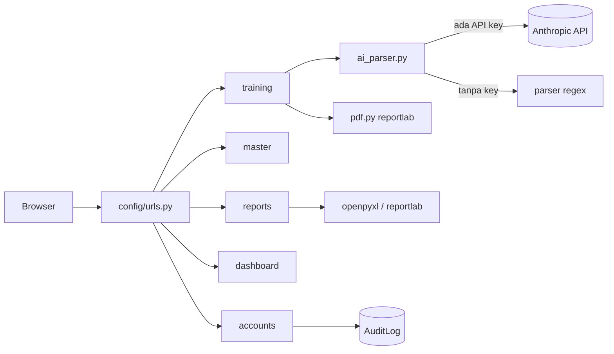
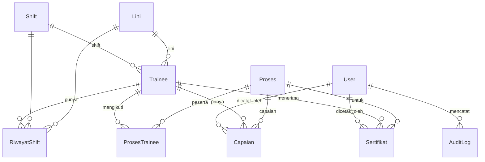

---

## tags: [arsitektur, STA] updated: 2026-10-25

# Arsitektur

Kembali ke [[00 AI Context]].

## Gambaran umum

Aplikasi Django monolit dengan template server-side. Lima app, satu database SQLite.

## Struktur folder

|Path|Fungsi|
|---|---|
|`config/`|settings, urls, wsgi/asgi|
|`accounts/`|User kustom, login, kelola Trainer, AuditLog, dekorator peran, context processor menu|
|`master/`|Proses, Shift, Lini (master data)|
|`training/`|Trainee, ProsesTrainee, Capaian, Sertifikat; parsing, evaluasi, PDF; `factories.py`, `seed_demo`|
|`dashboard/`|Dashboard Super Admin dan Trainer|
|`reports/`|Rekap harian/bulanan (xlsx, pdf)|
|`templates/`|Template per app + `base.html` + `partials/`|
|`static/`|`css/app.css`, `js/capaian.js`, `evaluasi.js`, `ekspor.js`|

## Routing

|Prefix|App|
|---|---|
|`/`|`accounts.views.home` (redirect ke login atau dashboard)|
|`/masuk/`, `/keluar/`, `/pengguna/`, `/audit-log/`|accounts|
|`/master/`|master|
|`/trainer/`|training|
|`/dashboard/`|dashboard|
|`/laporan/`|reports|
|`/admin/`|Django admin bawaan|

## Model data

### Perilaku penghapusan (`on_delete`)

- `Trainee` → `ProsesTrainee`, `Capaian`, `RiwayatShift`: **CASCADE**.
- `Trainee` → `Sertifikat`: **PROTECT** (trainee bersertifikat tidak bisa dihapus).
- `Proses` dipakai `ProsesTrainee`, `Capaian`, `Sertifikat`: **PROTECT**. View master menangkap `ProtectedError` dan menampilkan pesan.
- `Shift` di `RiwayatShift`: **PROTECT**; di `Trainee`: SET_NULL.
- `Lini`: SET_NULL.
- Relasi ke `User` (`dicatat_oleh`, `dicetak_oleh`, `AuditLog.user`): SET_NULL. `AuditLog.username` menyimpan nama sebagai teks agar jejak tetap ada.

## Alur data utama

1. **Manpower:** `.docx` atau teks → `docx_reader.extract_text` → `ai_parser.parse_manpower` → `_annotate` (ok/gagal/duplikat) → Trainer koreksi → simpan (`transaction.atomic`) → `Trainee` + `RiwayatShift` → audit log.
2. **Capaian:** `CapaianForm` → cek data aktif sama → konfirmasi timpa → lama `aktif=False`, baru dibuat → `ProsesTrainee` dibuat bila belum ada → audit log.
3. **Sertifikat:** `evaluasi_trainee` (rekomendasi) → Trainer verifikasi → dalam `atomic`: buat `Sertifikat`, set `QUALIFIED`, uji bangun PDF → commit → audit log. PDF dibuat ulang saat diunduh lewat `sertifikat_pdf`.
4. **Laporan:** `parse_periode` → `rekap_rows` (agregasi `Capaian` aktif) → `build_xlsx` / `build_pdf` → audit log.

## Lapisan akses

- `accounts/decorators.py::role_required` membungkus view. Belum login → halaman masuk; peran salah → pesan error + redirect ke `home_url` pengguna.
- `accounts/context_processors.py::navigation` menyusun menu sesuai peran dan menandai menu aktif.

## Konfigurasi (env)

|Variabel|Default|Fungsi|
|---|---|---|
|`DJANGO_SECRET_KEY`|kunci dev|wajib diganti di produksi|
|`DJANGO_DEBUG`|`1`|set `0` di produksi|
|`DJANGO_ALLOWED_HOSTS`|`localhost,127.0.0.1,testserver`||
|`ANTHROPIC_API_KEY`|kosong|kosong = parser regex|
|`ANTHROPIC_MODEL`|`claude-sonnet-5-5`|model untuk parsing|
|`QUALIFY_THRESHOLD`|`0.9`||
|`TRAINING_WARNING_RATIO`|`0.9`||
|`CONTRACT_WARNING_DAYS`|`30`||

## Dependensi

Django 5.1–5.2, openpyxl, reportlab, python-docx. Chart.js dari CDN (dashboard Super Admin).